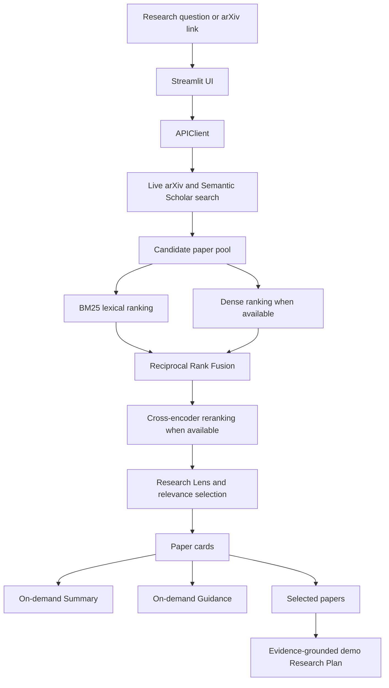

# AcademicForge

AcademicForge is an AI research engineer for turning a question into a focused, evidence-grounded **Research Plan**.

Designed for the **AMD Developer Hackathon (Track 3: Unicorn Track)**, it brings live academic retrieval, hybrid ranking, paper-level insight, and selected-paper synthesis into one workflow:

```text
Question -> Papers -> Plan
```

This branch is the public **Streamlit Cloud demo** of AcademicForge. It deliberately preserves the product workflow and visual style of the AMD deployment while using a lightweight, in-process generation path that can run without a private API key or GPU.

---

## Runtime Profiles

| Capability | AMD GPU branch (`amd-rocm-only`) | This Streamlit Cloud demo |
| --- | --- | --- |
| Interface | Streamlit | Same Streamlit interface and Research Lens workflow |
| Retrieval | Live arXiv + Semantic Scholar, hybrid ranking | Same live sources and hybrid ranking, with resilient lexical fallback |
| Fast Mode | Local `google/gemma-2-2b-it` through PyTorch/ROCm | Lightweight, evidence-grounded demo generator |
| Deep Mode | Optional Fireworks AI / DeepSeek when configured | Visible for product context, disabled with an in-app explanation |
| Backend | FastAPI on the AMD VM | In-process adapter inside the Streamlit process |
| Secrets required | Hugging Face token for gated weights; Fireworks key only for Deep Mode | None |

The Cloud demo does **not** claim to run Gemma, AMD ROCm, Fireworks, or DeepSeek. For the full local-first model experience, use the `amd-rocm-only` branch.

---

## Problem

Research-minded builders have to translate scattered academic papers into a concrete engineering decision. Paper search tools return lists. Generic assistants often produce ungrounded summaries. AcademicForge keeps papers as visible inputs, lets the user choose the most relevant ones, then produces one coherent Research Plan.

---

## Product Workflow

1. Ask a research question or paste an arXiv link.
2. Choose one Research Lens: Balanced, Foundational, Survey, Implementation Focused, Evaluation Focused, Alternative Approach, or Contrarian View.
3. Review paper cards, each with a source, category, abstract, and on-demand Summary or Guidance.
4. Select the papers that should ground the answer.
5. Generate one Research Plan focused on what to build, key findings, tradeoffs, and next steps.

Paper cards are inputs. The Research Plan is the product output.

---

## Architecture



### Cloud-specific execution path

In this branch, `frontend/api_client.py` detects that no `ACADEMICFORGE_BACKEND_URL` is configured. It then calls the existing retrieval, summary, guidance, and Research Plan modules inside the Streamlit process. This removes the need to host a second FastAPI service on Streamlit Cloud.

The adapter keeps the same logical API contracts used by the AMD deployment: `/search`, `/summarize`, `/paper-guidance`, and `/research-plan/stream`. It uses a lightweight deterministic demo generator so the public demo starts quickly and needs no private credentials.

---

## Retrieval Pipeline

AcademicForge fetches new candidates for each query; it does not rely on a fixed paper corpus.

- **arXiv and Semantic Scholar:** live candidate sources.
- **BM25:** exact-term matching across title, abstract, and metadata.
- **Dense ranking:** semantic similarity with `BAAI/bge-small-en-v1.5` when `sentence-transformers` is available. A lexical cosine fallback keeps the demo usable when it is not.
- **RRF:** combines lexical and semantic rank lists without comparing incompatible raw scores.
- **Cross-encoder reranking:** uses `BAAI/bge-reranker-base` when available; otherwise retains the fused order.
- **Relevance and domain checks:** discard low-relevance candidates and avoid synthesizing an obviously unrelated evidence set.
- **Research Lens:** influences candidate selection and the style of the resulting plan. `Balanced` means no category restriction.

This gives the Cloud demo the same retrieval story as the AMD application without requiring it to download GPU-scale model weights.

---

## Generation Modes

### Fast Mode (Demo)

Fast Mode creates concise paper summaries, practical paper guidance, and a structured Research Plan from the selected papers and their abstracts. It is intentionally a lightweight public demonstration of the AcademicForge workflow, not a substitute for the local Gemma model.

### Deep Mode (Disabled in this demo)

Deep Mode remains visible so users can understand the full product architecture. Selecting it shows a clear notice rather than silently failing: the full DeepSeek/Fireworks path is available only in the AMD deployment with the required API credentials.

---

## Run Locally

```bash
git clone -b streamlit-cloud-demo https://github.com/shreyshrivastava/AcademicForge.git
cd AcademicForge
python3 -m venv venv
source venv/bin/activate
pip install -r requirements.txt
streamlit run frontend/streamlit_app.py
```

No backend process or API key is required for this demo branch.

---

## Deploy to Streamlit Cloud

Use these deployment settings:

- **Repository:** `https://github.com/shreyshrivastava/AcademicForge`
- **Branch:** `streamlit-cloud-demo`
- **Main file path:** `frontend/streamlit_app.py`
- **Requirements file:** `requirements.txt`

Do not set `ACADEMICFORGE_BACKEND_URL` in Streamlit Cloud secrets. Leaving it unset activates the self-contained demo runtime.

---

## Repository Map

```text
AcademicForge/
├── backend/
│   ├── data_pipeline.py            # live retrieval, ranking, relevance, lens selection
│   ├── retrieval/                  # BM25, dense search, RRF, reranking
│   ├── summarizer.py               # paper summaries
│   ├── guidance_generator.py       # per-paper practical guidance
│   └── research_plan_generator.py  # selected-paper Research Plan generation
├── frontend/
│   ├── api_client.py               # HTTP client or Streamlit Cloud in-process adapter
│   └── streamlit_app.py            # responsive product UI
├── docs/
│   └── architecture.md             # detailed deployment architecture
└── requirements.txt                # lean Cloud dependency set
```

---

## Limitations of the Public Demo

- External paper APIs may rate-limit anonymous requests.
- The demo generator is intentionally lightweight and should not be represented as local Gemma or DeepSeek inference.
- Deep Mode is not available without the AMD deployment and Fireworks configuration.

---

## Full Product Deployment

For local Gemma inference on AMD ROCm hardware and the optional Fireworks Deep Mode, use the [`amd-rocm-only`](https://github.com/shreyshrivastava/AcademicForge/tree/amd-rocm-only) branch.

## License

MIT. See [LICENSE](LICENSE).
