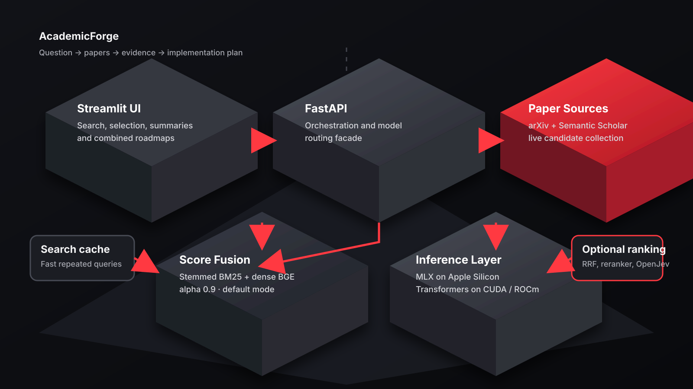
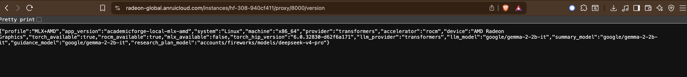

# AcademicForge

AcademicForge is for a graduate student who has found several papers and needs to decide what to implement next. Unlike a paper finder that stops at retrieval, it lets the student select evidence and produces one implementation-oriented Research Plan from that chosen set.

Run it locally on Apple Silicon, NVIDIA CUDA, or AMD ROCm. Summaries, paper guidance, and research plans use a local model by default, with optional cloud providers for generation.


[Getting started](#getting-started) · [How it works](#how-it-works) · [Evidence](#evidence) · [Configuration](#configuration) · [Troubleshooting](#troubleshooting) · [Contributing](CONTRIBUTING.md)

## Evidence

### Retrieval ablation status

The reproducible ablation runner evaluates the production retrieval components on BEIR SciFact and NFCorpus. It is deliberately guarded: it refuses to write a result artifact when BGE dense retrieval or the BGE cross-encoder is unavailable. A full supported-device run has not completed in this checkout, so no hybrid or reranker metrics are claimed yet.

<!-- BEGIN GENERATED ABLATION TABLE -->
| Dataset | BM25 | Stemmed BM25 | BGE dense | RRF | RRF + cross-encoder |
| :--- | :--- | :--- | :--- | :--- | :--- |
| BEIR SciFact | Prior baseline below | Not yet measured | Not yet measured | Not yet measured | Not yet measured |
| BEIR NFCorpus | Not yet measured | Not yet measured | Not yet measured | Not yet measured | Not yet measured |
<!-- END GENERATED ABLATION TABLE -->

Run the complete ablation on a device where BGE embedding and reranking can finish:

```bash
python -m benchmarks.run_scifact --download --device cuda
```

The runner records nDCG@10, Recall@10, MRR@10, 1,000-resample bootstrap confidence intervals, paired tests against BM25, prepared-index p50/p95 latency, hardware, and dataset checksums in `docs/benchmarks/retrieval-ablation.json`. See the [benchmark guide](docs/benchmarks/README.md) for the prior measured BM25 baseline and the exact caveats.

### Generated-output faithfulness screen

On 21 October 2026, the local `mlx-community/gemma-2-2b-it-4bit` model completed 20 fixed-query summaries. The BGE sentence-support heuristic marked 63 of 63 generated sentences as similar enough to at least one sentence from the retrieved abstracts at a cosine threshold of 0.62. This is a screening result, not proof of factual correctness: similarity can miss paraphrases and can accept a related but contradicted claim. The [artifact](docs/benchmarks/faithfulness.json), [method](benchmarks/faithfulness.py), and [blind human-evaluation template](docs/benchmarks/human_eval_template.csv) retain the auditable inputs and limitations.

### Real example

The [RAG hallucination Research Plan](docs/examples/rag-hallucination-research-plan.md) was generated from a live search using three retrieved papers, local Gemma summaries, and the same Research Plan generator served by FastAPI. Recreate it with:

```bash
python -m benchmarks.generate_example --device mps
```

## What you can do

- **Find relevant papers.** Search arXiv and Semantic Scholar using keywords and meaning, then view ranked results.
- **Choose your evidence.** Select the papers you want to use for your research.
- **Understand each paper.** Generate a short summary and practical guidance.
- **Build a research plan.** Combine selected papers into a structured plan and watch it appear as it is generated.
- **Save your work.** Download the output as Markdown.
- **Choose how to run.** Use local Gemma models or enable a cloud provider when you need one.

## Getting started

For a lightweight demo without API keys or a backend, use the [standalone Streamlit profile](docs/streamlit_cloud.md). It shares this interface and live search, uses BM25 ranking and a small open-source CPU model, and falls back to extractive evidence analysis when the model is unavailable.

You need Python 3.12–3.14 with `venv` support, Git, and an internet connection for paper searches and initial model downloads. Choose the dependency file for your hardware below. GPU setups also need a working CUDA or ROCm environment.

### 1. Download the project

```bash
git clone https://github.com/shreyshrivastava/AcademicForge.git
cd AcademicForge

python3 -m venv venv
source venv/bin/activate
python -m pip install --upgrade pip setuptools wheel
```

### 2. Install dependencies

Run the command for your machine:

```bash
# Apple Silicon or a standard Python setup
python -m pip install --ignore-installed blinker -r requirements-local.txt
```

```bash
# NVIDIA VM with a verified CUDA PyTorch 2.12.x stack already installed
python -m scripts.install_gpu cuda
```

```bash
# AMD VM with a verified ROCm PyTorch 2.12.x stack already installed
python -m scripts.install_gpu rocm
```

### 3. Configure your model

```bash
cp .env.example .env
```

Edit `.env` and set the model for your machine:

| Machine | `LOCAL_LLM_PROVIDER` | `LOCAL_LLM_MODEL` |
| :--- | :--- | :--- |
| Apple Silicon | `mlx` | `mlx-community/gemma-2-2b-it-4bit` |
| NVIDIA CUDA or AMD ROCm | `transformers` | `google/gemma-2-2b-it` |

The example file uses `LOCAL_LLM_PROVIDER=auto` and leaves the model unset, so the app chooses the correct platform model. Use the table above if you want to set it explicitly. GPU installation preserves your VM's existing PyTorch stack and checks it before installing application packages. See [GPU setup](docs/setup.md#gpu-vms) for the supported profile and verification steps.

For gated Hugging Face models such as Gemma, accept the model's access terms and add `HF_TOKEN` to `.env`. Cloud API keys are optional.

### 4. Start the app

```bash
./start.sh
```

Open [AcademicForge at localhost:8501](http://127.0.0.1:8501). The script starts the backend and frontend together, waits up to ten minutes for readiness, and stops both processes if either exits. The first start can take longer while model weights download and load. Local access uses loopback by default; [VM access](docs/setup.md#network-access) requires explicit configuration.

To check the backend runtime:

```bash
curl http://127.0.0.1:8000/version
```

## Try it

1. Enter a question, such as **“Reducing hallucinations in retrieval augmented generation.”**
2. Choose a **Search field**, analysis mode, and research lens, then search for papers. For RAG or RAGAS, choose **Computer science & AI**. Use **Other field…** to enter a subject such as quantum physics.
3. Select the papers you want to explore.
4. Generate a summary or guidance for an individual paper.
5. Create a research plan from your selected papers and download the Markdown output.

### Search in a specific field

Use **Search field** to distinguish terms that mean different things in different subjects:

- **Computer science & AI:** expands RAG to retrieval augmented generation and recognizes RAGAS, including “rag as” and “rag and as.”
- **Music & arts:** keeps the music meaning of ragas.
- **Medicine & health** and **Energy & environment:** narrow results to those fields.
- **Other field…:** enter your own subject. Custom fields match their words in paper titles, abstracts, and available categories.
- **All fields:** keeps the existing broad search behavior.

The app previews the interpreted query, labels the field used for the displayed results, and asks you to search again after changing fields. It keeps separate cached results for each field and carries the original question and chosen field into research plans. See [search field behavior](docs/search-fields.md) for details.

## How it works

AcademicForge uses Streamlit for the interface and FastAPI for the backend. Search finds and ranks papers; the generation model turns your selected evidence into summaries, guidance, and a research plan.

### 3D architecture



### Research workflow

```text
Your research question
  -> Search arXiv and Semantic Scholar
  -> Rank papers by keywords (BM25) and meaning (BGE embeddings)
  -> Combine rankings with Reciprocal Rank Fusion (RRF)
  -> Refine the order with a BGE cross-encoder
  -> Optionally rerank top papers with OpenJev in Quality search mode
  -> Choose the papers to use as evidence
  -> Generate summaries and paper guidance
  -> Build and stream a research plan
```

Completed searches are cached in memory for five minutes by default, making repeated queries with the same filters and search mode faster.

### Technology

| Part | Tools |
| :--- | :--- |
| Interface | Streamlit |
| Backend | FastAPI and Uvicorn |
| Paper sources | arXiv and Semantic Scholar |
| Search and ranking | BM25, BGE embeddings, RRF, and `BAAI/bge-reranker-base` |
| Optional final ranking | OpenJev |
| Local generation | Gemma through MLX or Transformers/PyTorch |
| Optional cloud generation | Groq for Deep mode; Fireworks DeepSeek when enabled |

See [the architecture guide](docs/architecture.md) for more detail.

## Search and generation modes

Search mode controls the order of papers. Analysis mode controls the model used to write summaries and guidance. Configure them separately.

| Search mode | What it does | When to use it |
| :--- | :--- | :--- |
| **Fast** (default) | Combines keyword and meaning-based ranking with the BGE reranker. | Everyday searches with lower latency. |
| **Quality** | Adds an OpenJev ranking pass when OpenJev is enabled and available. | Searches where you want an extra relevance check on the top papers. |

Both search modes use the same generation settings. Changing search mode changes paper ordering; it does not change the writing model or prompts.

### Optional: local OpenJev ranking

On Apple Silicon, start the MLX OpenJev server in a separate terminal with your virtual environment activated:

```bash
python -m scripts.start_openjev_mlx
```

Then set these values in `.env` and start or restart AcademicForge:

```dotenv
ACADEMICFORGE_SEARCH_MODE=quality
JEV_ENABLED=true
JEV_ENDPOINT=http://127.0.0.1:3000/v1/systemone
JEV_MODEL=openjev
JEV_MAX_PAPERS=10
```

The helper downloads the OpenJev MLX model on first use, so allow additional disk space and memory. `JEV_MAX_PAPERS` sets the number of results to rerank; the code default is `3`, and the example above uses `10`. If OpenJev is unavailable or times out, the app keeps the original ranking.

### Optional: cloud generation

To use Groq for Deep summaries, guidance, and research plans, set these values in `.env`:

```dotenv
REMOTE_LLM_USE_FOR_DEEP=true
REMOTE_LLM_PROVIDER=groq
GROQ_API_KEY=your-groq-key
REMOTE_LLM_MODEL=openai/gpt-oss-120b
```

To enable Fireworks DeepSeek generation, add `FIREWORKS_API_KEY` and set `LOCAL_LLM_USE_FIREWORKS=true`. Configure one cloud path at a time. Fast analysis continues to use the local model.

## Configuration

Copy [.env.example](.env.example) to `.env` and set only what you need. Restart the app after changing settings.

| Variable | Default | Purpose |
| :--- | :--- | :--- |
| `HF_TOKEN` | Unset | Access gated Hugging Face model downloads. |
| `LOCAL_LLM_PROVIDER` | `auto` | Choose MLX on Apple Silicon or Transformers elsewhere. |
| `LOCAL_LLM_MODEL` | Depends on runtime | Choose the local generation model. |
| `LOCAL_LLM_DEEP_MODEL` | Local model, or enabled cloud model | Choose the Deep generation model. |
| `LOCAL_LLM_RESEARCH_PLAN_MODEL` | Deep model | Choose the research plan model. |
| `LOCAL_LLM_MAX_TOKENS` | `2500` | Set the output token limit. |
| `LOCAL_LLM_TEMPERATURE` | `0.2` | Control how varied generated text is. |
| `ACADEMICFORGE_SEARCH_MODE` | `fast` | Choose `fast` or `quality` paper ranking. |
| `ACADEMICFORGE_SEARCH_CACHE_TTL_SECONDS` | `300` | Set how long completed searches stay in memory. |
| `ACADEMICFORGE_RETRIEVAL_DEVICE` | `auto` | Choose the ranking device; use `cpu` to reduce GPU memory use. |
| `ACADEMICFORGE_BACKEND_URL` | `http://127.0.0.1:8000` | Set the backend address for Streamlit when started separately. |
| `JEV_ENABLED` | `false` | Enable OpenJev in Quality search mode. |
| `REMOTE_LLM_USE_FOR_DEEP` | `false` | Enable a configured cloud provider for Deep generation. |
| `GROQ_API_KEY` | Unset | Authenticate with Groq for optional Deep generation. |
| `FIREWORKS_API_KEY` | Unset | Authenticate with Fireworks. |
| `LOCAL_LLM_USE_FIREWORKS` | `false` | Enable Fireworks generation explicitly. |
| `ACADEMICFORGE_BIND_HOST` | `127.0.0.1` | Set the interface used by the launcher. |
| `ACADEMICFORGE_API_KEY` | Unset | Protect the backend; required by the launcher for network exposure. |
| `ACADEMICFORGE_STARTUP_TIMEOUT_SECONDS` | `600` | Limit startup waiting. |
| `ACADEMICFORGE_GENERATION_CONCURRENCY` | `1` | Limit simultaneous generation; excess work gets HTTP 429. |
| `ACADEMICFORGE_SEARCH_CONCURRENCY` | `2` | Limit simultaneous searches. |
| `ACADEMICFORGE_CLOUD_TIMEOUT_SECONDS` | `45` | Set each cloud request's SDK timeout. |
| `ACADEMICFORGE_MAX_REQUEST_BYTES` | `1048576` | Limit request bodies, including chunked bodies. |
| `ACADEMICFORGE_REQUESTS_PER_MINUTE` | `60` | Limit requests per client IP per process. |

The startup script uses backend port `8000` and frontend port `8501`. Both processes read `.env` as configuration. Dependencies are recorded in `pyproject.toml` and `uv.lock`; pip requirement files are generated from that lock.

## API

| Endpoint | Purpose |
| :--- | :--- |
| `GET /live` | Check that the API process responds. |
| `GET /health` | Check per-component readiness; HTTP 503 until generation is ready. |
| `GET /version` | View runtime, accelerator, model, and retrieval device details. |
| `GET /config` | View public model and mode settings. |
| `POST /search` | Find and rank papers. |
| `POST /summarize` | Generate a paper summary. |
| `POST /paper-guidance` | Generate practical guidance for a paper. |
| `POST /research-plan` | Generate a complete research plan. |
| `POST /research-plan/stream` | Stream NDJSON `start`, `delta`, `done`, or `error` events. |

Search responses include source status and warnings when results are incomplete. Total source failure returns HTTP 503. Generation responses report the actual provider and any local fallback. Interrupted streams stop with an explicit error; they are never silently replayed after partial output.

## Troubleshooting

**Why is the first start slow?**

The app downloads and loads local generation and ranking models. Later starts reuse the downloaded weights. Check `GET /health` for model readiness.

**Why does a model download fail?**

For gated models, check that your Hugging Face account has access and that `HF_TOKEN` is set in `.env`. On Apple Silicon, also check that `LOCAL_LLM_MODEL` points to the MLX model shown in the setup table.

**How do I check GPU use?**

Call `GET /version`. NVIDIA should report `"accelerator":"cuda"`; AMD should report `"accelerator":"rocm"`. On ROCm, `"retrieval_device":"cuda"` is expected because PyTorch uses the same device API for AMD and NVIDIA GPUs.

**What if GPU memory is limited?**

Set `ACADEMICFORGE_RETRIEVAL_DEVICE=cpu` in `.env` to move search ranking models to the CPU.

**How do I open the app on a remote VM?**

Forward ports `8501` and `8000`, or use your VM provider's proxy. On the Radeon notebook VM used for testing, the app path is `/instances/<instance-id>/proxy/8501/` and diagnostics are at `/instances/<instance-id>/proxy/8000/version`.

**Where can I report a problem?**

Open an [issue](https://github.com/shreyshrivastava/AcademicForge/issues) with the steps to reproduce it and any relevant error output.

### AMD ROCm example



This runtime response shows the backend running on Linux with Transformers and an AMD Radeon GPU through ROCm.

## Project structure

```text
AcademicForge/
├── backend/                 FastAPI routes, model settings, and generation
│   └── retrieval/           Keyword search, embeddings, ranking, and devices
├── frontend/                Streamlit interface
├── scripts/                 Model downloads and local OpenJev startup
├── tests/                   API, generation, routing, and search checks
├── docs/                    Setup guides, architecture, and screenshots
├── .env.example             Example configuration
├── requirements-local.txt   Shared dependencies and Apple Silicon support
├── requirements-cuda.txt    NVIDIA CUDA dependencies
├── requirements-rocm.txt    AMD ROCm dependencies
└── start.sh                 Start the backend and frontend
```

## Development

After installing dependencies, run the checks:

```bash
python -m pip install -r requirements-dev.txt
python -m pytest -q
python -m ruff check backend frontend scripts tests benchmarks
python -m compileall -q backend frontend scripts tests benchmarks
bash -n start.sh
```


See [CONTRIBUTING.md](CONTRIBUTING.md) for contribution guidelines and [docs/setup.md](docs/setup.md) for additional setup notes.

## License

AcademicForge is available under the [MIT License](LICENSE).
