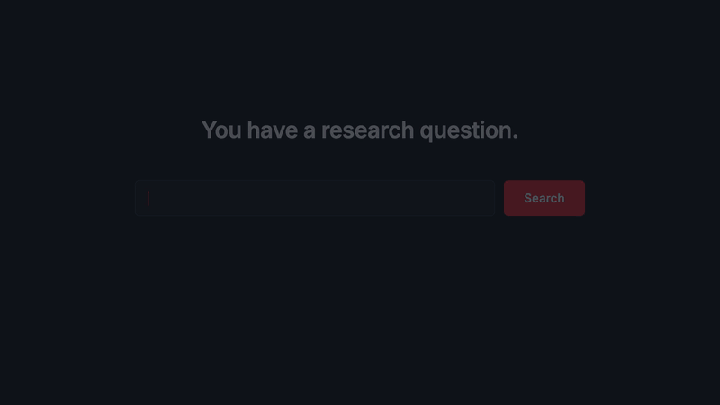
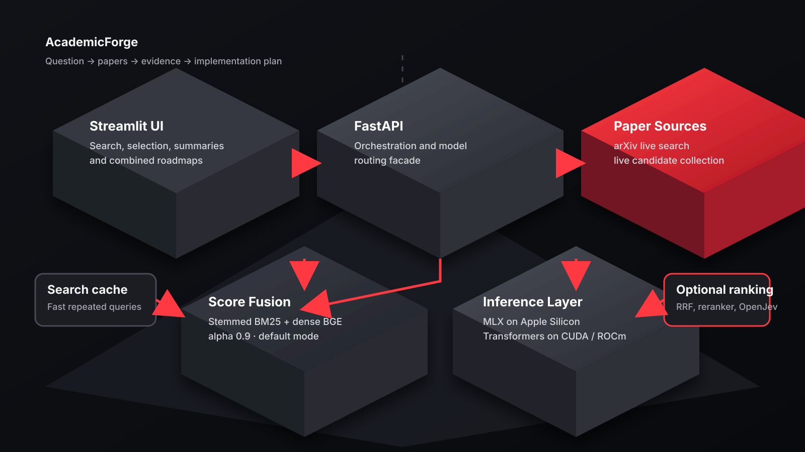
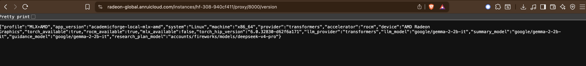

# AcademicForge

[](https://github.com/shreyshrivastava/AcademicForge/actions/workflows/ci.yml)


AcademicForge helps you go from a research question to a build plan. You ask a question, it finds and ranks papers, you tick the ones that fit, and it writes one research plan from that set with each finding cited back to a paper.

It runs on your own machine (Apple Silicon, NVIDIA CUDA or AMD ROCm) with a local Gemma model. Cloud models are optional.



[Watch the 22-second demo with sound](docs/assets/academicforge-demo.mp4?raw=true)

[Getting started](#getting-started) · [Try it](#try-it) · [How it works](#how-it-works) · [Faithfulness check](#faithfulness-check) · [Benchmarks](#benchmarks) · [Configuration](#configuration) · [Troubleshooting](#troubleshooting) · [Contributing](CONTRIBUTING.md)

## What it does

You type a question and AcademicForge searches arXiv, then ranks the papers by both keywords and meaning. You tick the papers you want to use. Any paper can get a short summary or practical guidance on how to use it. Then it writes a research plan from your selection and streams it in as it goes. You can download the plan as Markdown.

Semantic Scholar is a second, optional source. It turns on when you add a free `SEMANTIC_SCHOLAR_API_KEY` to `.env`. Without a key it stays off, because its public API refuses almost every anonymous request.

## Getting started

For a lightweight demo with no API keys and no backend, use the [standalone Streamlit profile](docs/streamlit_cloud.md). It has the same interface and live search, ranks with BM25, and uses a small CPU model with extracted evidence as a fallback.

For the full app you need Python 3.12 to 3.14 with `venv`, Git, and an internet connection for paper searches and the first model download. GPU machines also need a working CUDA or ROCm setup.

### 1. Download the project

```bash
git clone https://github.com/shreyshrivastava/AcademicForge.git
cd AcademicForge
python3 -m venv venv
source venv/bin/activate
python -m pip install --upgrade pip setuptools wheel
```

### 2. Install dependencies

```bash
# Apple Silicon or a standard Python setup
python -m pip install --ignore-installed blinker -r requirements-local.txt
```

The Blinker reinstall works around a preinstalled copy in some macOS Python setups.

```bash
# NVIDIA VM with a verified CUDA PyTorch 2.12.x stack already installed
python -m scripts.install_gpu cuda
```

```bash
# AMD VM with a verified ROCm PyTorch 2.12.x stack already installed
python -m scripts.install_gpu rocm
```

The GPU installer keeps your VM's PyTorch, checks the accelerator, and then installs the app's locked packages. See [GPU setup](docs/setup.md#gpu-vms).

### 3. Configure

```bash
cp .env.example .env
```

The example file uses `LOCAL_LLM_PROVIDER=auto`, which picks the right model for your machine:

| Machine | `LOCAL_LLM_PROVIDER` | `LOCAL_LLM_MODEL` |
| :--- | :--- | :--- |
| Apple Silicon | `mlx` | `mlx-community/gemma-2-2b-it-4bit` |
| NVIDIA CUDA or AMD ROCm | `transformers` | `google/gemma-2-2b-it` |

Gemma is a gated model on Hugging Face, so accept its terms and add `HF_TOKEN` to `.env`. Everything else is optional.

### 4. Start the app

```bash
./start.sh
```

Open [localhost:8501](http://127.0.0.1:8501). The script starts the backend and the interface together, waits up to ten minutes for the models to load, and stops both if either exits. The first start is slower while model weights download. The app listens on loopback only unless you [configure network access](docs/setup.md#network-access).

To check the backend:

```bash
curl http://127.0.0.1:8000/version
```

## Try it

1. Type a question, for example "Reducing hallucinations in retrieval augmented generation".
2. Pick a **Field**, **Lens** and **Model** under the question box and press **Search**. For RAG or RAGAS, choose **Computer science & AI**. **Other field…** lets you type a subject such as quantum physics.
3. Tick **Use in plan** on the papers you want. The top three are ticked for you.
4. Press **Summary** or **Guidance** on any paper to read about it on its own.
5. Press **Write plan**, then **Download Markdown** to keep it.

You can also open a search straight from a link: `http://127.0.0.1:8501/?query=your+question&run=1`.

### Fields

The **Field** setting separates terms that mean different things in different subjects:

- **Computer science & AI** expands RAG to retrieval augmented generation and recognizes RAGAS, including "rag as" and "rag and as".
- **Music & arts** keeps the music meaning of ragas.
- **Medicine & health** and **Energy & environment** narrow results to those fields.
- **Other field…** matches your own words in titles, abstracts and categories.
- **All fields** searches broadly.

The app shows how it read your query and asks you to search again after you change the field. Each field keeps its own cached results. See [search fields](docs/search-fields.md).

## How it works

Streamlit draws the interface and FastAPI runs the backend. Search finds and ranks papers, and the generation model turns the papers you pick into summaries, guidance and a plan.

### 3D architecture



```text
Your question
  -> search arXiv (and Semantic Scholar when a key is set)
  -> rank with score fusion: stemmed BM25 + BGE dense, alpha 0.9
     (dense-only, RRF hybrid and a BGE cross-encoder are opt-in)
  -> optional OpenJev pass on the top papers in Quality search mode
  -> you pick the papers
  -> summaries and guidance per paper
  -> one research plan, streamed
```

Finished searches stay cached in memory for five minutes, so repeating a query with the same settings is instant.

| Part | Tools |
| :--- | :--- |
| Interface | Streamlit (design notes in [DESIGN.md](DESIGN.md)) |
| Backend | FastAPI and Uvicorn |
| Paper sources | arXiv; Semantic Scholar with an API key |
| Ranking | Score fusion of stemmed BM25 and `BAAI/bge-small-en-v1.5`; opt-in RRF and `BAAI/bge-reranker-base` |
| Optional final ranking | OpenJev, an HTTP service that rescores the top few papers and keeps the original order if it fails |
| Local generation | Gemma through MLX or Transformers |
| Optional cloud generation | Groq for Deep mode; Fireworks DeepSeek when enabled |

More detail is in [the architecture guide](docs/architecture.md).

### Search mode and model

`ACADEMICFORGE_SEARCH_MODE` sets how papers are ordered. The **Model** choice in the app (Fast or Deep) sets which model writes the text. They are independent.

| Search mode | What it does |
| :--- | :--- |
| `fast` (default) | Score fusion only. Set `ACADEMICFORGE_RETRIEVAL_MODE=hybrid_rerank` to add the cross-encoder. |
| `quality` | Adds an OpenJev pass on the top papers when OpenJev is running. |

To run OpenJev locally on Apple Silicon, start it in a second terminal:

```bash
python -m scripts.start_openjev_mlx
```

Then add to `.env` and restart:

```dotenv
ACADEMICFORGE_SEARCH_MODE=quality
JEV_ENABLED=true
JEV_ENDPOINT=http://127.0.0.1:3000/v1/systemone
JEV_MODEL=openjev
JEV_MAX_PAPERS=10
```

The helper downloads the OpenJev model on first use. `JEV_MAX_PAPERS` is how many top results it rescores (default 3).

### Cloud generation

To use Groq for Deep mode, add:

```dotenv
REMOTE_LLM_USE_FOR_DEEP=true
REMOTE_LLM_PROVIDER=groq
GROQ_API_KEY=your-groq-key
REMOTE_LLM_MODEL=openai/gpt-oss-120b
```

For Fireworks DeepSeek, add `FIREWORKS_API_KEY` and `LOCAL_LLM_USE_FIREWORKS=true`. Use one cloud provider at a time. Fast mode always uses the local model.

## Faithfulness check

This check looks for summaries that drift away from their papers. The local Gemma model (`mlx-community/gemma-2-2b-it-4bit`) wrote summaries for 20 fixed questions, 63 sentences in all. Each sentence was compared with the sentences of the paper's abstract using BGE embeddings, and counted as supported when the closest match scored at least 0.80.

At that threshold about two thirds of the real summary sentences counted as supported. The rest weren't necessarily wrong, often just reworded too far for the similarity score. To see whether the check catches real problems, it was also run on deliberately broken summaries: sentences swapped in from the wrong paper, invented claims, and conclusions flipped to their opposite. It caught the swapped and invented sentences, and most of the flipped conclusions, but not all of them.

So treat this as a screen that points at summaries worth a second look. It does not show that a summary is correct. It ran with the earlier prompts, before the plain-writing rule, and needs a re-run to describe the current version. The data and method are in [faithfulness.json](docs/benchmarks/faithfulness.json), [faithfulness_controls.json](docs/benchmarks/faithfulness_controls.json) and [benchmarks/faithfulness.py](benchmarks/faithfulness.py). Retrieval numbers are in [Benchmarks](#benchmarks) below.

## Benchmarks

These are offline measurements on public datasets. They describe how the ranking step orders abstracts, not how good a finished plan is, and they don't cover live search, full papers or human judgment.

### Retrieval on BEIR SciFact

| System | nDCG@10 | 95% bootstrap CI | Difference vs dense-only (95% CI) |
| :--- | ---: | :--- | :--- |
| BGE dense-only | 0.7200 | 0.6776–0.7635 | |
| Stemmed BM25 | 0.6514 | 0.6058–0.6951 | −0.0686 (−0.1063 to −0.0309) |
| Equal-weight RRF | 0.7076 | 0.6656–0.7513 | −0.0124 (−0.0392 to 0.0169) |
| Best weighted RRF | 0.7233 | 0.6800–0.7628 | +0.0033 (−0.0109 to 0.0189) |
| Best score fusion (default) | 0.7306 | 0.6877–0.7728 | +0.0106 (−0.0037 to 0.0268) |
| Best score fusion + reranker@20 | 0.7278 | 0.6836–0.7697 | +0.0078 (−0.0198 to 0.0351) |

One run on the full SciFact test set (300 queries, 5,183 abstracts) on Apple Silicon, with 1,000 paired bootstrap resamples. Settings were chosen on the training judgments. Score fusion scored highest, but its gain over dense-only is inside the noise here, and the reranker didn't add anything.

### Retrieval on BEIR NFCorpus

| System | nDCG@10 (95% CI) | Difference vs dense-only (95% CI) |
| :--- | :--- | :--- |
| Dense-only | 0.3374 (0.3014–0.3752) | |
| Stemmed BM25 | 0.3053 (0.2737–0.3390) | −0.0322 (−0.0530 to −0.0100) |
| Equal RRF | 0.3422 (0.3082–0.3790) | +0.0048 (−0.0100 to 0.0212) |
| Weighted RRF | 0.3505 (0.3152–0.3866) | +0.0130 (0.0047 to 0.0205) |
| Score fusion | 0.3551 (0.3192–0.3930) | +0.0177 (0.0108 to 0.0253) |

Run once with the settings frozen from SciFact. Here the small gain from score fusion was outside the noise, which is why it is the default. The reasoning and a dated note on the decision rule are in the [benchmark guide](docs/benchmarks/README.md).

### Plan citations

In a run of 10 fixed questions with three papers each, the plans cited only the papers that were selected, and most Key Findings bullets carried a citation. That run used the earlier prompts. A spot check with the current prompts cited fewer findings, so this needs a re-run before quoting a number. The check only confirms that a citation points at a selected paper, not that the paper supports the claim. Data: [plan_faithfulness.json](docs/benchmarks/plan_faithfulness.json).

### Example plan

[This RAG hallucination plan](docs/examples/rag-hallucination-research-plan.md) came from a live search, local Gemma summaries and the same plan generator the app uses. Recreate it with:

```bash
python -m benchmarks.generate_example --device mps
```

## Configuration

Copy [.env.example](.env.example) to `.env` and set only what you need. Restart after changes.

| Variable | Default | Purpose |
| :--- | :--- | :--- |
| `HF_TOKEN` | Unset | Download gated Hugging Face models. |
| `SEMANTIC_SCHOLAR_API_KEY` | Unset | Turn on Semantic Scholar as a second source. Get a free key at semanticscholar.org/product/api. |
| `LOCAL_LLM_PROVIDER` | `auto` | MLX on Apple Silicon, Transformers elsewhere. |
| `LOCAL_LLM_MODEL` | Depends on machine | The local generation model. |
| `LOCAL_LLM_DEEP_MODEL` | Local model, or the enabled cloud model | The Deep mode model. |
| `LOCAL_LLM_RESEARCH_PLAN_MODEL` | Deep model | The research plan model. |
| `LOCAL_LLM_MAX_TOKENS` | `2500` | Output token limit. |
| `LOCAL_LLM_TEMPERATURE` | `0.2` | How varied the generated text is. |
| `ACADEMICFORGE_SEARCH_MODE` | `fast` | `fast` or `quality` ranking. |
| `ACADEMICFORGE_RETRIEVAL_MODE` | `score_fusion` | `score_fusion`, `dense`, `hybrid` or `hybrid_rerank`. |
| `ACADEMICFORGE_SEARCH_CACHE_TTL_SECONDS` | `300` | How long finished searches stay cached. |
| `ACADEMICFORGE_RETRIEVAL_DEVICE` | `auto` | Ranking device; `cpu` saves GPU memory. |
| `ACADEMICFORGE_BACKEND_URL` | `http://127.0.0.1:8000` | Backend address when Streamlit runs on its own. |
| `JEV_ENABLED` | `false` | Turn on OpenJev in Quality mode. |
| `REMOTE_LLM_USE_FOR_DEEP` | `false` | Use a cloud provider for Deep mode. |
| `GROQ_API_KEY` | Unset | Groq key for Deep mode. |
| `FIREWORKS_API_KEY` | Unset | Fireworks key. |
| `LOCAL_LLM_USE_FIREWORKS` | `false` | Turn on Fireworks generation. |
| `ACADEMICFORGE_BIND_HOST` | `127.0.0.1` | Interface the launcher listens on. |
| `ACADEMICFORGE_API_KEY` | Unset | Protects the backend; the launcher requires it for network access. |
| `ACADEMICFORGE_STARTUP_TIMEOUT_SECONDS` | `600` | How long startup waits for models. |
| `ACADEMICFORGE_GENERATION_CONCURRENCY` | `1` | Simultaneous generations; extra requests get HTTP 429. |
| `ACADEMICFORGE_SEARCH_CONCURRENCY` | `2` | Simultaneous searches. |
| `ACADEMICFORGE_CLOUD_TIMEOUT_SECONDS` | `45` | Timeout for each cloud request. |
| `ACADEMICFORGE_MAX_REQUEST_BYTES` | `1048576` | Largest request body accepted. |
| `ACADEMICFORGE_REQUESTS_PER_MINUTE` | `60` | Requests per client IP per process. |

The launcher uses port `8000` for the backend and `8501` for the interface. Dependencies are locked in `pyproject.toml` and `uv.lock`, and the pip requirement files are generated from the lock. The Streamlit theme is pinned in `.streamlit/config.toml`.

## API

| Endpoint | Purpose |
| :--- | :--- |
| `GET /live` | The API process is up. |
| `GET /health` | Per-component readiness; HTTP 503 until generation is ready. |
| `GET /version` | Runtime, accelerator, model and retrieval device. |
| `GET /config` | Public model and mode settings. |
| `POST /search` | Find and rank papers. |
| `POST /summarize` | Summarize one paper. |
| `POST /paper-guidance` | Practical guidance for one paper. |
| `POST /research-plan` | A complete research plan. |
| `POST /research-plan/stream` | The plan as NDJSON `start`, `delta`, `done` or `error` events. |

Search responses list each source's status and a warning when a source fails. If every source fails, search returns HTTP 503. Generation responses name the provider that answered and say when the local model stood in for a cloud one. A stream that breaks ends with an error event and is never replayed after partial output.

## Troubleshooting

**The first start is slow.** The app downloads and loads the generation and ranking models. Later starts reuse them. `GET /health` shows readiness.

**A model download fails.** Check that your Hugging Face account has access to Gemma and that `HF_TOKEN` is in `.env`. On Apple Silicon, `LOCAL_LLM_MODEL` should be the MLX model from the setup table.

**I don't see Semantic Scholar papers.** It only runs with `SEMANTIC_SCHOLAR_API_KEY` set. Without a key, search uses arXiv alone.

**Is it using the GPU?** Call `GET /version`. NVIDIA reports `"accelerator":"cuda"` and AMD reports `"accelerator":"rocm"`. On ROCm, `"retrieval_device":"cuda"` is expected, because PyTorch uses the same device name for both.

**GPU memory is tight.** Set `ACADEMICFORGE_RETRIEVAL_DEVICE=cpu` to move the ranking models to the CPU.

**How do I open it on a remote VM?** Forward ports `8501` and `8000`, or use your provider's proxy. On the Radeon notebook VM used for testing, the app is at `/instances/<instance-id>/proxy/8501/` and diagnostics at `/instances/<instance-id>/proxy/8000/version`.

**Where do I report a problem?** Open an [issue](https://github.com/shreyshrivastava/AcademicForge/issues) with the steps to reproduce it and any error output.



The response above is the backend running on Linux with Transformers on an AMD Radeon GPU through ROCm.

## Project structure

```text
AcademicForge/
├── backend/                 FastAPI routes, search, ranking glue and generation
│   └── retrieval/           BM25, embeddings, fusion, reranking and devices
├── frontend/                Streamlit interface and styles
├── benchmarks/              SciFact, NFCorpus and faithfulness evaluations
├── scripts/                 Model downloads, GPU install, OpenJev, review scorers
├── tests/                   API, generation, search and interface checks
├── docs/                    Setup, architecture, benchmarks and screenshots
├── DESIGN.md                Colors, type, layout and copy rules for the interface
├── .env.example             Example configuration
├── requirements-local.txt   Locked dependencies for Apple Silicon and standard Python
├── requirements-gpu.txt     Locked CUDA/ROCm packages for scripts/install_gpu.py
└── start.sh                 Starts the backend and interface
```

## Development

```bash
python -m pip install -r requirements-dev.txt
python -m pytest -q
python -m ruff check backend frontend scripts tests benchmarks
python -m compileall -q backend frontend scripts tests benchmarks
bash -n start.sh
```

See [CONTRIBUTING.md](CONTRIBUTING.md) and [docs/setup.md](docs/setup.md) for more.

## License

MIT. See [LICENSE](LICENSE).
